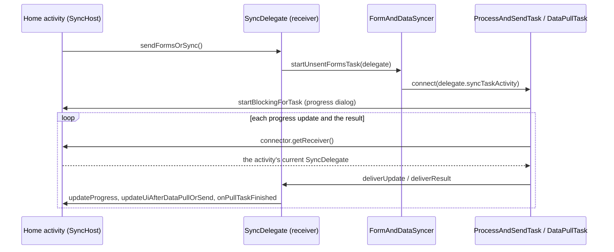

# Sync Task Wiring

How a home screen's form send and data pull reach `SyncDelegate`, and why the activity stays in the loop.

## Roles

- **`SyncHost`**: what the delegate needs from the activity it syncs for. `HomeActivityHost` extends it; `PostRequestActivity` implements it directly.
- **`SyncDelegate`**: starts sends and pulls through `FormAndDataSyncer`, and is the *receiver* their results and progress are delivered to.
- **`SyncHost.syncTaskActivity`**: the `CommCareActivity` the tasks connect to, their *connector*. It owns what `CommCareActivity` gives every task: the progress dialog, Cancel, the send-to-pull dialog hand-off, the wakelock and reconnection through `TaskConnectorViewModel`.

## Flow



`HomeScreenBaseActivity.getReceiver()` returns its coordinator's `SyncDelegate`, and `FormAndDataSyncer` and `ProcessAndSendTask` are typed on the delegate.

## Rotation

The task asks its connector for the receiver on every delivery rather than holding one. When the activity is recreated, `CommCareActivity.onDestroy` disconnects the task and the new activity's `onCreate` reconnects it through `TaskConnectorViewModel.attach`, so the next delivery lands on the new activity's delegate:

```
old activity onDestroy -> TaskConnectorViewModel.detach()      task.connector = null
new activity onCreate  -> TaskConnectorViewModel.attach(new)   task.connector = new activity
task delivers          -> new activity.getReceiver()           -> new SyncDelegate
```

Any change to this wiring must keep that late lookup. `HomeSyncTest` pins it ("a sync running across a rotation reports to the new home's sync delegate").

## PostRequestActivity

`PostRequestActivity` also runs a `ModernHttpTask`, which needs the activity as its receiver, and a connector has one receiver type. So it keeps `getReceiver()` returning itself and forwards the three `PullTaskResultReceiver` callbacks to its own `SyncDelegate`.
