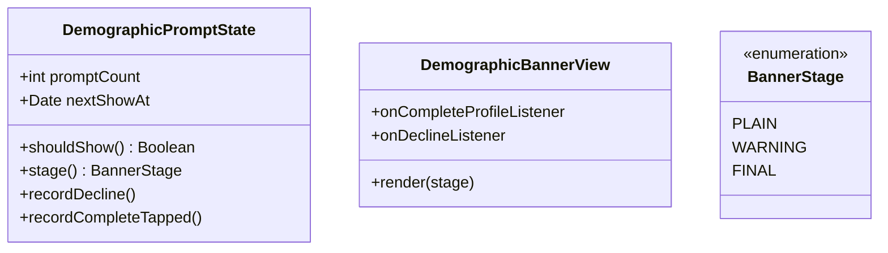
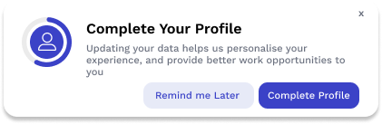

# Demographic Data Collection — Tech Spec

Ticket: [CCCT-2465](https://dimagi.atlassian.net/browse/CCCT-2465) ·
Epic: [CCCT-2464](https://dimagi.atlassian.net/browse/CCCT-2464) ·
Idea: [CCC-160](https://dimagi.atlassian.net/browse/CCC-160) ·
[Design doc](https://docs.google.com/document/d/19l6u_PgYIOtBxSQTScXRrnH4ypgUCGVZCLwtuaTRchY/edit) ·
[Figma](https://www.figma.com/design/fOs1LmimJRTMyhhJAMvEG5/Demographic-Data-Collection)

Target release 2.66.

## Summary

Six demographic fields need to be added to the PersonalID profile.

Collection at sign-up was rejected — user research found it hurts completion. The worker fills
the fields in at their own pace, and may save them a few at a time.

## Scope

| Release | What |
|---|---|
| **V0 (must)** | The six fields on the profile and edit screens; the nudge banner |
| **V1 (should)** | Push notification if still incomplete after a while |

## What we collect

| Field | Input | Options |
|---|---|---|
| Gender | dropdown | Female · Male · Prefer not to say |
| Date of birth | date picker | |
| Languages spoken | *not specified — see open questions* | |
| Education | dropdown | No formal education · High school · College Diploma · Bachelors Degree · Masters Degree or higher |
| Experience as a CHW | dropdown | No experience · 1–2 years · 3–5 years · 6+ years |
| Technical proficiency | dropdown | No technical experience · Beginner · Comfortable with technology · Advanced User · Expert |

None are mandatory: a partly filled profile saves fine and Save is never blocked. The warning
border on an empty field is a reminder that it still needs filling in, not a validation error.

## Mobile design

Nothing new is needed on the profile screens beyond the six fields. The only genuinely new piece
is the banner and the state that decides which stage it shows.

| Component | Status | Responsibility |
|---|---|---|
| `OpportunityHomeFragment` | existing (CCCT-2523) | Hosts the banner above the learning or delivery surface |
| `DemographicBannerView` | **new** | Renders the stage and reports which button was tapped |
| `DemographicPromptState` | **new** | Counts prompts, holds the next-show time, picks the stage |
| `PersonalIdProfileFragment` | existing | Shows the six fields, read only |
| `PersonalIdProfileEditFragment` | existing | Edits them; two sections, sticky Save/Cancel, partial save |
| `ConnectUserRecord` | existing | Stores the six fields |

The banner hangs off `OpportunityHomeFragment` rather than the learning and delivery surfaces, so
one instance survives the learning-to-delivery swap instead of each surface building its own. The
view belongs in `org.commcare.views.connect` alongside the existing cards.

**This differs from the Figma, which places the banner on the opportunity listing page.** A worker
deep in an opportunity may not return to the listing often, so the prompt could go unseen for a
long time — Opportunity Home is on the path of their everyday work.

Both profile screens split into *Personal Information* and *Work Experience*. The edit screen
moves Save and Cancel into a sticky footer because the form now scrolls.

### The two new classes



`DemographicPromptState` makes the whole decision: it reads the user record for completeness and
checks its own timer. `OpportunityHomeFragment` only asks and, if the answer is yes, passes the
stage to `DemographicBannerView.render(stage)` — it decides nothing itself, and the view stays
dumb. `DemographicPromptState` is responsible for updating `promptCount` and `nextShowAt` in
`PersonalIdUserPreferences`, not on the user record — see Storage.

Both taps leave the view through its listeners; it never writes anything itself:

```
decline tap  → onDeclineListener → fragment → DemographicPromptState.recordDecline()
complete tap → onCompleteProfileListener → fragment → DemographicPromptState.recordCompleteTapped()
                                              → profile edit screen
```

Both methods do the same thing to the state: raise `promptCount` and push `nextShowAt` out 24
hours. The app cannot tell whether a worker who opened the edit screen actually saved anything —
they may cancel — so there is nothing to distinguish on. Twenty-four hours later the prompt is
skipped if the profile is complete, and otherwise shown at whatever stage `promptCount` has
reached.

They stay as two methods so each can report its own Firebase event from here rather than from the
fragment, keeping the analytics with the state that changed.

**Saving goes to the server first, then persists locally** — the same order the existing name
change uses. A save therefore needs a connection, and a worker offline keeps seeing the banner.
Partial saves mean they may go round this loop several times before the profile is complete.

## Prompt behaviour

[Banner designs in Figma](https://www.figma.com/design/fOs1LmimJRTMyhhJAMvEG5/Demographic-Data-Collection?node-id=96-113)



The banner shows on Opportunity Home whenever the profile is incomplete and the worker is not
inside a 24-hour snooze. Declining always snoozes for 24 hours and always shows the toast
*"We'll remind you to update your profile tomorrow"*. What changes with each response is the banner
copy and, on the last stage, the button label.

| Stage | Shown | Extra copy | Decline button |
| --- | --- | --- | --- |
| 1 | 1st and 2nd time | — | Remind me Later |
| 2 | 3rd time, after 2 responses | Amber: *"Delivery tasks may be interrupted tomorrow, if your profile information is not updated."* | Remind me Later |
| 3 | after 3 responses, every time thereafter | Red: *"Please update your profile by clicking the Update Info button, or accessing your profile from the menu, to continue working without interruption."* | Dismiss |

* **Complete Profile** opens the profile edit screen.
* **There is no close (X) control** — declining is only through the Remind me Later / Dismiss
  button. The Figma and the screenshot above still show an X; it is not in the implementation.
* Stage 3 repeats indefinitely: the banner returns every 24 hours until the profile is complete.
  *Dismiss* behaves the same as *Remind me Later*; only the label changes, to stop implying the
  worker will be asked again on their own terms.
* The banner stops for good once all six fields are filled, from whichever stage it is on.

## Storage

Six new fields on `ConnectUserRecord` at `@Persisting(18..23)`, all nullable.

The Connect DB is at version 30 (`ConnectDatabaseSchemaManager.DB_VERSION_CONNECT`). This needs a
bump to 31 plus a `ConnectUserRecordV30` snapshot and a `fromV30()` migration, matching how
`ConnectJobRecordV21`/`fromV21()` already work.

### What is stored and what is computed

Only two values are stored for the prompt. Everything else is derived on read.

| Value | Where it lives |
|---|---|
| The six demographic fields | server, mirrored in `ConnectUserRecord` |
| `promptCount` | `PersonalIdUserPreferences` |
| `nextShowAt` | `PersonalIdUserPreferences` |

| Value | Computed from |
|---|---|
| `stage()` | `promptCount` — 0 or 1 gives PLAIN, 2 gives WARNING, 3 or more gives FINAL |
| `shouldShow()` | profile incomplete **and** `now >= nextShowAt`, both read inside the state |
| profile completeness | whether all six fields on the record are set |

## Server API

Two changes, both on existing endpoints.

**`POST /users/update_profile`** already takes a `Map<String, String>` body with a bearer token
(`PersonalIdApiEndpoints.UPDATE_PROFILE`, called from `ApiPersonalId.updateProfile`). Today it
sends at most three keys, each omitted when null:

```json
{
  "name": "Amina Yusuf",
  "secondary_phone": "+254700000000",
  "photo": "<base64>"
}
```

The six new keys join them on the same endpoint, also optional so a partial save works:

```json
{
  "name": "Amina Yusuf",
  "secondary_phone": "+254700000000",
  "photo": "<base64>",

  "gender": "female",
  "date_of_birth": "1994-03-21",
  "languages": "en,sw",
  "education": "bachelors_degree",
  "chw_experience": "3_5_years",
  "tech_proficiency": "comfortable"
}
```

No key is ever sent with a null value, so an untouched field is absent rather than blank — the
server should treat absence as "unchanged", not "clear it".

**`POST /users/recover/complete_recovery`** must return the same six fields, so a worker who
reinstalls or moves device sees what they already entered and is not prompted again from stage 1.

There is no profile-fetch endpoint today. Profile data reaches a new device through
`complete_recovery`, which `CompleteRecoveryParser` already reads `email`, `username` and `photo`
from, so the six fields belong there too. For a new account there is nothing to fetch: the worker
types the values and they are saved through `update_profile`.

Two further things to agree with the server team:

* Stored values should be stable enum keys, not display labels, so the dropdown wording can be
  translated or reworded without breaking the data.
* Whether `languages` is a list or a comma-separated string.

## Push notification

V1. A reminder for workers who have not filled the profile in, so the nudge does not depend on
them opening the app.

### Payload

```json
{
  "notification_type": "PERSONALID",
  "action": "ccc_generic_opportunity",
  "notification_id": "b70a4694-e121-XXXXX-8243-42d3de1816f7",
  "title": "Complete your profile",
  "body": "Please complete your profile to continue working without interruption",
  "key": "complete_profile"
}
```

### Mobile work

The plumbing is already there. `FirebaseMessagingUtil` promotes `key` over `action` whenever the
action is `ccc_generic_opportunity`, so `complete_profile` arrives as the destination and
`PushNotificationRecord` already parses `notification_type`, `action` and `key`. What is missing is
a handler for this particular key.

| Work | Where |
|---|---|
| Add the `complete_profile` key constant | `ConnectConstants` |
| Route that destination to the profile edit screen | the destination handling in `FirebaseMessagingUtil` and `NotificationsSyncWorkerManager` |
| Confirm no opportunity sync runs for it | `NotificationsSyncWorkerManager.parseAndStartNotificationWorker` |

The last one matters: `action` says `ccc_generic_opportunity`, but this notification is about the
profile and has no opportunity attached. The existing `when` branches on the resolved destination,
so `complete_profile` should fall through without starting the opportunity and job-progress sync
workers — worth asserting in a test rather than assuming.

### Server work

* Decide when to send: how long after the profile is still incomplete, and how often to repeat.
* Stop sending once all six fields are filled.
* Only send to workers who have a Connect account, matching the feature's scope.

Tapping the notification opens the profile edit screen. It does not change `promptCount`; the
banner's own 24-hour cycle carries on independently.

## Implementation tickets

### Mobile

| # | Title | Covers |
|---|---|---|
| 1 | Prompt workers to complete their demographic profile | Banner on Opportunity Home, the three stages, response handling and the 24-hour cycle |
| 2 | Add the demographic fields to the profile and edit screens | The six fields, the two sections, warning borders and partial save |
| 3 | Send and receive demographic fields over the PersonalID API | `update_profile` on save, `complete_recovery` on a new device |
| 4 | Handle the complete-profile push notification | Route the `complete_profile` key to the profile edit screen |
| 5 | Report analytics for the demographic prompt | Events for each banner shown, decline, complete tap and profile save |

### Server

| # | Title | Covers |
|---|---|---|
| 6 | Accept and return the demographic fields on the PersonalID API | Six optional keys on `update_profile`, the same six returned by `complete_recovery` |
| 7 | Send the complete-profile push notification | Who to send to, when to start, how often to repeat, and stopping once the profile is complete |

Tickets 1 and 2 can be taken in parallel. Tickets 3 and 4 each depend on their server
counterpart, 6 and 7. Ticket 5 follows ticket 1, since the events fire from
`DemographicPromptState`.

## Open questions

These block sign-off. The first needs product or design; the last two need a call between
mobile and server.

1. **Languages spoken has no options defined.** Every other field now has its list. Still under
   discussion: a fixed list, free text, or multi-select, and whether the app's supported locales
   are the right set.
2. **Prompt count on a new device.** Held on the device, so a reinstall starts the worker back
   at stage 1. Acceptable, or should the server hold it?
3. **Who computes profile completion?** The design doc mentions "100% profile completion". If that
   figure is shown anywhere, mobile and server need to agree on how it is calculated.
